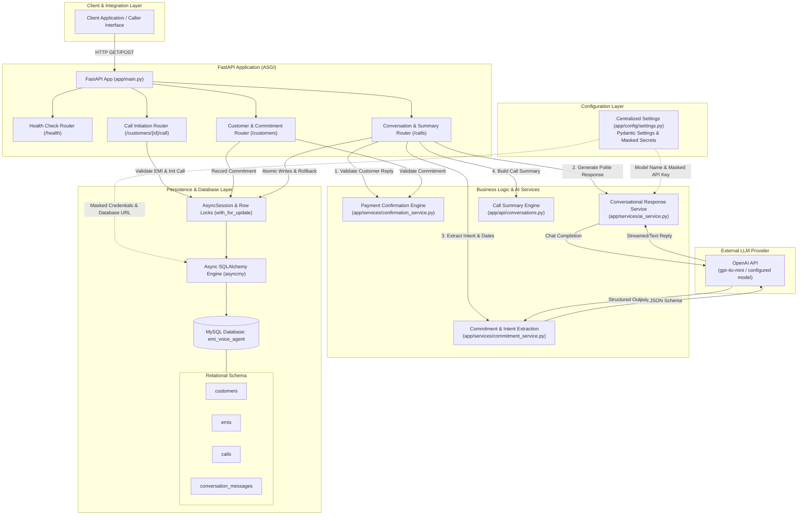
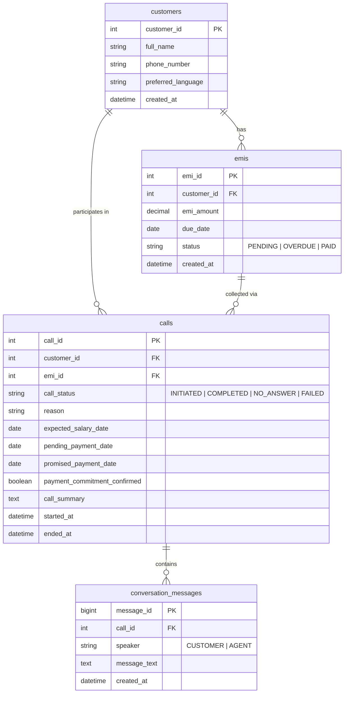

# System Architecture — AI EMI Collection Voice Agent

## 1. High-Level Architecture Diagram

---

## 2. Core Architecture Principles

### A. Backend Authority Over Financial Commitments
- The Language Model (LLM) is strictly treated as an untrusted dialogue generator and natural language parser. It **cannot** directly update database records, finalize payment dates, or mark commitments confirmed.
- A payment promise is finalized **only** when the backend [confirmation_service.py](file:///c:/Users/udayk/Downloads/EMI-Voice-agent/app/services/confirmation_service.py) verifies that:
  1. An active `pending_payment_date` proposal exists on the call record, established through the conversational workflow (`POST /calls/{call_id}/message`).
  2. The actual stored latest agent message (`speaker == "AGENT"`) asked the customer to confirm that specific payment date.
  3. The customer returned an unambiguous affirmative response (`CONFIRMED`) matching the pending date.
  4. No tentative or ambiguous language (`"maybe"`, `"I will try"`, `"cannot guarantee"`) or conflicting payment dates were present.
- The commitment endpoint (`POST /customers/{customer_id}/commitment`) cannot create or replace a pending date proposal (rejecting unconfirmed date submissions with HTTP 409 Conflict), preventing arbitrary pending date injection outside the conversational workflow.

### B. Concurrency Control and Transaction Atomicity
- All state modifications (customer message insertion, agent reply insertion, pending proposal updates, confirmed date finalization, and call status transitions) occur within a single atomic SQLAlchemy `AsyncSession` transaction.
- Target call rows are locked using `with_for_update()` during message processing and commitment updates to prevent race conditions or contradictory state updates from concurrent API calls.
- If any service fails during a request (such as an LLM timeout or database constraint error), `db.rollback()` executes, leaving no orphaned messages or partial commitments.

### C. Sentence-Bounded Date & Intent Extraction
- The date extractor evaluates sentence boundaries (`.`, `!`, `?`, `;`, `\n`) and inspects question clauses strictly ending in `?`.
- Historical statements, EMI due dates (e.g., `"Your EMI of INR 8,500 was due on 10 October"`), and acknowledgment clauses (`"I understand that 25 October is tentative"`) are strictly separated from confirmation questions.
- A proposed date is stored as `pending_payment_date` only when the agent explicitly asks the customer to confirm that specific date.

---

## 3. Database Schema Overview

---

## 4. Operational Boundaries and Scope

- **Simulation Mode:** The application is built as a simulated, text-based voice agent MVP. Live telephony connections (SIP / WebRTC), audio streaming, and automatic speech recognition / text-to-speech (STT/TTS) are not integrated.
- **Model Boundaries:** The OpenAI client uses bounded retries with exponential backoff on transient errors (`408`, `409`, `429`, `5xx`), while failing fast without looping on permanent client errors (`401`, `403`, `404`).
