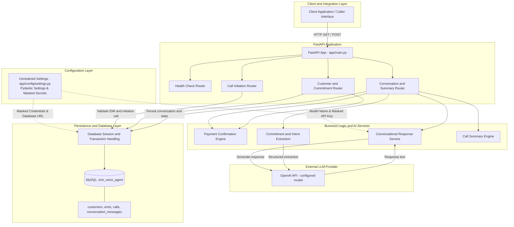
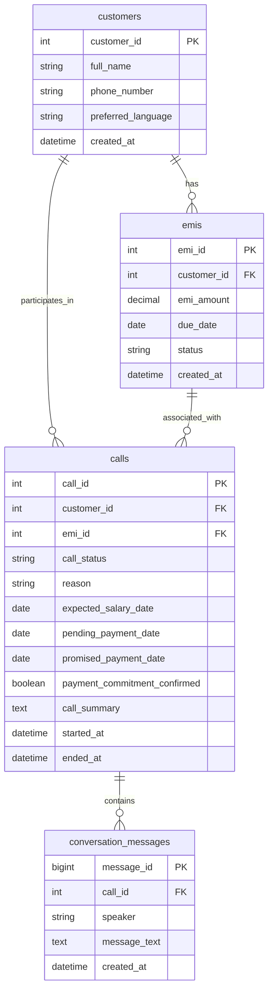

# System Architecture — AI EMI Collection Voice Agent

## 1. High-Level Architecture Diagram

The diagram represents the intended application architecture. Exact implementation details should be verified against the current source code.

## 2. Core Architecture Principles

### A. Backend Authority Over Financial Commitments

The LLM assists with natural-language understanding, intent extraction, and conversational responses. The backend must remain authoritative for payment commitment state.

A payment promise must not be treated as confirmed merely because the LLM extracts a date or generates an affirmative-looking response.

The intended confirmation safeguards are:

1. A specific proposed payment date is available as an active `pending_payment_date` established through the conversation workflow (`POST /calls/{call_id}/message`).
2. The agent explicitly asked the customer to confirm that date in a date-specific confirmation question (persisted as an agent message in `conversation_messages`).
3. The customer's response contains an unambiguous confirmation of the same date.
4. Tentative, contradictory, or ambiguous language does not finalize the commitment.
5. The backend validates the confirmation before persisting the confirmed payment date.
6. The commitment endpoint (`POST /customers/{customer_id}/commitment`) cannot create or replace a pending date proposal (rejecting unconfirmed date submissions with HTTP 409 Conflict), ensuring proposals are strictly established through the conversation workflow.

The confirmation service is located at `app/services/confirmation_service.py`. Verify the exact validation rules in that file before describing every safeguard as implemented.

### B. Transaction Integrity and Concurrency

Conversation processing may involve storing customer messages, generating an agent response, updating a pending payment date, confirming a commitment, and changing call status.

These related changes should be handled consistently so a failed request does not leave contradictory records.

Recommended safeguards include:

- Use database transactions for related writes.
- Roll back the transaction if a database operation fails.
- Lock the relevant call record when necessary to prevent conflicting concurrent updates.
- Keep pending payment proposals separate from confirmed commitments.
- Avoid marking an EMI as paid merely because a call or payment commitment is completed.

**Implementation status:** Transaction atomicity, rollback on exceptions (`db.rollback()`), and pessimistic row locking (`with_for_update()`) are verified and implemented in `POST /calls/{call_id}/message`, `POST /customers/{customer_id}/commitment`, and `POST /calls/{call_id}/summary` to safeguard concurrent call state.

### C. Date and Intent Extraction

The agent may encounter dates referring to different events, including:

- The EMI due date.
- The customer's expected salary date.
- A proposed payment date.
- A date mentioned tentatively or as historical context.
- A callback date or time.

These dates must not be treated as interchangeable.

A proposed payment date should become pending only when the conversation flow identifies it as a payment proposal. It should become confirmed only after the required confirmation checks succeed.

Date extraction should distinguish questions, historical statements, tentative language, and explicit confirmation. Verify the exact sentence-boundary and question-parsing rules against the implementation before documenting them as guaranteed behavior.

## 3. Database Schema Overview

The following diagram describes the intended relationships. Confirm the actual SQLAlchemy models and database constraints for exact column types, nullability, and foreign keys.

### Table responsibilities

- `customers`: Customer identity and contact details.
- `emis`: EMI amount, due date, and payment status.
- `calls`: Call lifecycle, customer reason, payment-date proposals, confirmation state, and summary.
- `conversation_messages`: Customer and agent messages associated with a call.

## 4. API and Request Flow

The application exposes these core workflows:

| Endpoint | Purpose |
|---|---|
| `GET /health` | Check application health |
| `GET /health/database` | Check database connectivity |
| `GET /customers/{customer_id}/emi` | Retrieve customer and EMI information |
| `POST /customers/{customer_id}/call` | Initiate a simulated call |
| `POST /calls/{call_id}/message` | Process a conversation message |
| `POST /customers/{customer_id}/commitment` | Record non-date details or finalize an existing pending payment commitment |
| `POST /calls/{call_id}/summary` | Retrieve or generate a call summary |

The exact request schemas, response schemas, and status codes are documented in `API_DOCUMENTATION.md`.

## 5. Operational Boundaries and Scope

### A. Simulation Mode

This project is a simulated, text-based voice-agent MVP. Customer and agent messages are exchanged through REST APIs.

Live telephony, SIP or WebRTC audio streaming, and integrated speech-to-text (STT) and text-to-speech (TTS) are outside the current scope unless separately implemented.

### B. LLM Integration

The application uses an external OpenAI API model configured for the project. The model name should be read from the actual configuration rather than assumed from this document.

Keep API credentials in environment variables or an appropriate secrets manager. Never commit `.env` or real API keys to source control.

**Retry behavior:** Bounded retries, exponential backoff, and different handling for transient versus permanent API errors should be documented as implemented only after verifying the OpenAI client configuration.

### C. Financial-State Boundaries

- A proposed date is not a confirmed commitment.
- A confirmed commitment is not proof of payment.
- A completed call does not mean the EMI has been paid or cancelled.
- The EMI status should change to paid only through a separate, valid payment-verification workflow.

### D. Testing and Demonstration

Validate the application using the supplied test suite and representative scenarios, including:

- Salary delay with a proposed payment date.
- Insufficient funds without a payment commitment.
- Explicit promise-to-pay followed by confirmation.
- Wrong number.
- Customer unavailable or requesting a callback.
- Ambiguous or rejected confirmation.

Record actual test results in the project README rather than assuming that the architecture diagram proves every scenario works.

## 6. Related Documentation

- `README.md` — Setup, configuration, execution, and project overview.
- `API_DOCUMENTATION.md` — Endpoint details and request/response examples.
- `ARCHITECTURE.md` — Existing root-level architecture document.
- `SAMPLE_SCENARIOS.md` — Demonstration scenarios, if present.
